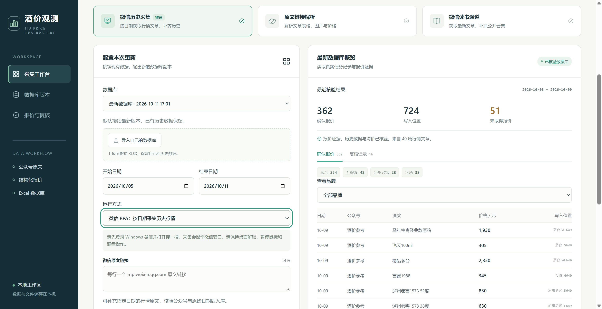

# 酒价观测

从 6 个公众号的行情文章中提取酒价，更新茅台、五粮液、泸州老窖和习酒的 Excel 数据库。支持按日期采集历史文章，也可以直接导入原文链接。

## 功能与流程

**功能 1：RPA 自动采集历史行情**

选择需要更新的日期区间，程序模拟人工在微信中搜索公众号、翻阅历史文章、打开行情原文，取得文章链接。随后读取文章公布的白酒价格，解析表格和图片，自动写入 Excel 数据库。

**功能 2：手动链接补录**

遇到漏采文章或缺少某天的数据时，可以在微信中手动复制行情原文链接，选择「原文链接解析」，每行粘贴一个链接后运行。程序沿用相同的识别和更新流程，补充对应日期的数据。

两种方式共用以下处理流程：

1. 读取正文和 HTML 表格，下载图片并运行本地 OCR。
2. 核对公众号、日期和价格列，匹配酒款与规格，保存 JSON 报价。
3. 按「日期 × 酒款 × 公众号」写入品牌页和 `Sheet1`，计算渠道均价，另存 Excel 并保留复核记录。

**为什么选择 RPA？**

微信生态相对封闭，文章访问限制较多，直接爬取列表接口不易长期维护。本工具选择模拟正常的搜索和阅读操作，减少对非公开列表接口的依赖，更便于在当前场景中维护。代价是采集期间需要让出鼠标和键盘。建议按需、低频采集；RPA 仍可能遇到验证或账号限制。

## 部署

在 Windows 电脑本地运行：

1. 安装 Python 3.11 或 3.12，安装时保留 **Python Launcher**。
2. 在仓库页面点击 **Code → Download ZIP**，解压到本地文件夹。
3. 双击 `首次安装.bat`，联网安装依赖，只需执行一次。
4. 双击 `启动工具.bat`，浏览器会打开 `http://127.0.0.1:8765/`。使用期间保持启动窗口开启。

## 使用

1. 点击 **导入自己的数据库**，上传同格式 XLSX。需要保留「更新手册、茅台、五粮液、泸州老窖、习酒、Sheet1」及原有品类、渠道表头。后续可默认接续最新版本。
2. 选择开始和结束日期，单次最多处理 32 天。
3. 选择采集方式：
   - **微信历史采集**：登录电脑微信并打开搜一搜，程序按日期查找行情文章。
   - **原文链接解析**：每行粘贴一个微信原文链接，直接解析表格和图片。
   - **微信读书**：可选通道，需另行部署 WeRSS 并授权；只能取得最新文章，历史补抓依赖公开合集。
4. 点击 **开始更新数据库**，界面会显示当前阶段、公众号和进度。完成后按提示下载 Excel，并检查报价与复核记录；部分采集失败会单独提示，可补录链接或重试。

也可在「导入文章与其他操作」中上传 TXT、HTML 或 CSV，再选择「更新已导入的文章」。

## 注意事项

- 微信 RPA 会操作鼠标和键盘，采集期间保持桌面解锁，暂停其他电脑操作；原文链接解析不占用微信窗口。
- 公众号未公布某个品类是正常缺失。程序保持空白，不填 0，也不沿用昨日价格。名称对照见 Excel 的「更新手册」。
- 遇到微信验证、图片识别不清或价格冲突时，需要根据复核记录补充链接或人工确认。
- 每次更新另存文件，原始上传文件保留。数据库和采集结果保存在本机，不随仓库分享。
- 默认使用本地 OCR，无需大模型 API Key。当前提供本机运行方式。

文章采集复用 [Dhaizei/wechat-article-rpa](https://github.com/Dhaizei/wechat-article-rpa)。感谢作者提供的微信 RPA 实现，本项目在此基础上增加了白酒价格识别和 Excel 更新功能。

许可证：[Apache-2.0](LICENSE)。扩展说明见 [MODIFICATIONS](wechat-article-rpa/MODIFICATIONS.md)。

## 暂停与日期范围

采集时点击进度区域的「暂停」。当前文章处理完并返回列表后显示「任务已暂停」，再点击「继续采集」即可从原公众号、原列表进度继续，已取得文章不会重跑。暂停时间不计入任务超时；页面刷新仍可显示暂停状态。保持启动窗口及微信列表打开，继续前不要改变该列表；关闭程序后不提供跨进程恢复。写入 Excel 阶段不显示暂停按钮，以保证数据库完整写入。

每个公众号先刷新主页并回到最新位置，再向下查找所选日期。选择 10 月 1—2 日时，明确超出范围的列表日期和标题日期会直接跳过，避免逐篇打开 10 月 9 日等较新行情文章。微信桌面列表没有可靠的直接日期跳转，仍需滚动经过较新的列表卡片；缺少明确日期的卡片保留原文日期核验，最终入库严格按所选区间。日志与进度区会区分列表翻阅、略过较新文章和原文采集。
